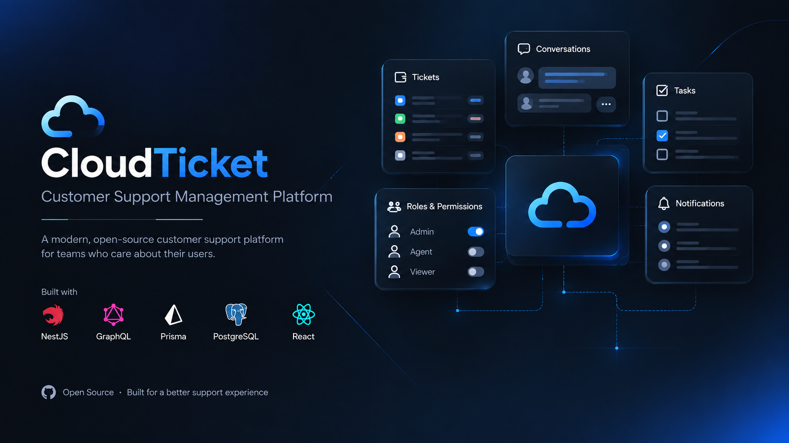

# CloudTicket

<p align="center">
  
</p>

<p align="center">
  A modern customer support management platform for managing tickets, customers, tasks, users, and permissions in one centralized system.
</p>

<p align="center">


</p>

---

## Overview

CloudTicket is a full-stack customer support management platform designed to help organizations manage customer conversations, support workflows, internal tasks, and user permissions.

The platform provides separate experiences for administrators, support agents, and customers, allowing teams to handle customer requests efficiently through a centralized ticketing system.

The project focuses on real-world business workflows, including ticket lifecycle management, task assignment, role-based access control, notifications, and relational data management.

---

## Features

### Ticket Management

* Create and manage customer support tickets
* Assign tickets to support agents
* Track ticket status and priority
* Customer-agent conversation system
* Internal ticket activities and history tracking
* Attachment support

---

### Task Management

* Create and assign tasks between team members
* Task priorities and statuses
* Due date management
* Task comments
* Activity tracking
* Personal task management for support agents

---

### User & Permission Management

* Multiple user types:

  * Administrators
  * Support Agents
  * Customers

* Custom role creation

* Permission-based access management

* Portal-based permission structure

* User role assignment

---

### Customer & Product Management

* Customer profiles
* Product management
* Customer-product relationships
* Support workflow based on customer information

---

## Architecture

CloudTicket follows a modular backend architecture.

```
                     React Application
                            |
                            |
                    Apollo GraphQL Client
                            |
                            |
                    NestJS GraphQL API
                            |
        -----------------------------------------
        |              |             |            |
      Auth         Tickets        Tasks       Users
        |              |             |            |
        -----------------------------------------
                            |
                       Prisma ORM
                            |
                       PostgreSQL
```

---

## Tech Stack

### Backend

* NestJS
* GraphQL
* Apollo Server
* Prisma ORM
* PostgreSQL
* Passport.js
* JWT Authentication
* bcrypt

### Frontend

* React
* Vite
* TypeScript
* Tailwind CSS

### Infrastructure

* Docker
* Docker Compose
* GitHub Actions
* Linux Deployment

---

## Authentication & Authorization

The application uses JWT-based authentication with role and permission management.

The authorization system supports:

* User roles
* Custom permissions
* Portal-based access control
* Protected application workflows

---

## Database Design

The application uses PostgreSQL with Prisma ORM.

Main entities include:

* Users
* Roles
* Permissions
* Portals
* Customers
* Products
* Tickets
* Messages
* Tasks
* Notifications
* Activities
* Departments

The database structure is designed around real business relationships between customers, support teams, and internal operations.

---

## Screenshots

Add application screenshots here:

```
docs/images/
│
├── hero.png
├── dashboard.png
├── tickets.png
├── tasks.png
└── permissions.png
```

Recommended screenshots:

* Admin Dashboard
* Ticket Conversation Page
* Task Management Page
* Role & Permission Management

---

## Local Development

### Clone repository

```bash
git clone https://github.com/Parsa-Barandaf/cloudticket.git

cd cloudticket
```

---

## Backend Setup

```bash
cd backend

npm install

npm run start:dev
```

---

## Environment Variables

Create a `.env` file:

```env
DATABASE_URL=
JWT_SECRET=
PORT=
```

---

## Docker Deployment

The project includes Docker configuration for running services in containers.

Build and start services:

```bash
docker compose up --build
```

---

## Engineering Highlights

This project demonstrates experience with:

* Designing modular backend systems
* Building GraphQL APIs
* Relational database modeling
* Authentication workflows
* Permission management systems
* Business process implementation
* Containerized deployment

---

## Future Improvements

Planned improvements:

* Expand automated testing coverage
* Improve authorization guards
* Add more analytics dashboards
* Improve audit logging
* Enhance notification workflows

---

## Author

Developed as a real-world client project.

Built with:

* NestJS
* React
* PostgreSQL
* Prisma
* GraphQL

```
CloudTicket
Customer Support Management Platform
```
